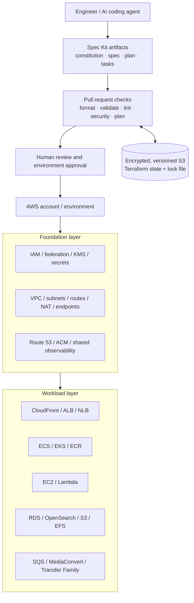

# AWS Platform Infrastructure as Code

> **A spec-driven, Terraform-based reference platform for repeatable AWS environments.**
>
> Design infrastructure from explicit requirements, review the plan, and promote changes through controlled environments—with security, reliability, cost, and operational ownership built in from the start.

[](https://developer.hashicorp.com/terraform)
[](https://aws.amazon.com/)
[](https://github.github.com/spec-kit/)

## 1. Project overview

**Repository:** `infra-spec`  
**Purpose:** Define reusable, reviewable AWS infrastructure patterns using Terraform and Spec Kit (spec-driven development).  
**Status:** Foundation / initial design. This repository is a starting point; AWS resources are not created until implementation, review, and an explicitly approved deployment.

This project is intended to grow into a practical platform repository for common application and data workloads. It brings together patterns for network foundations, container platforms, data services, object and shared-file storage, content delivery, managed file transfer, and event-driven processing.

It also serves as a learning project. Each infrastructure capability should answer three questions:

1. **What outcome is required?** Capture it in a specification before implementation.
2. **Why is this Terraform design appropriate?** Record architecture, trade-offs, inputs, outputs, dependencies, and operational considerations in the plan.
3. **How do we know it is safe and correct?** Validate the configuration, test reusable modules, inspect the plan, and document how to operate and recover the service.

The target is not one giant deployment that creates every AWS service. It is a **composable catalog of patterns** that can be selected and assembled for a specific environment and workload.

## 2. Goals and non-goals

### Goals

- Use **Spec Kit** to move from requirements to specifications, technical plans, ordered tasks, implementation, and convergence review.
- Learn Terraform progressively: providers, variables, locals, data sources, resources, modules, outputs, state, dependencies, plans, testing, and lifecycle controls.
- Create repeatable sandbox, staging, and production configurations with deliberate environment isolation.
- Establish secure defaults for identity, networking, encryption, secrets, logging, backups, and deployment approvals.
- Reduce configuration drift by making Terraform the declared owner of resources it manages.
- Support reviewable changes, documented decisions, and automated checks before deployment.
- Keep reusable modules small, composable, versioned, and independently understandable.
- Make cost, availability, recoverability, and operational support explicit design inputs.

### Non-goals

- Automatically migrate every existing AWS resource into Terraform without discovery, ownership mapping, and a reviewed migration plan.
- Deploy all listed services into every environment by default.
- Store application code, credentials, private keys, production data, Terraform state, or generated plan files in Git.
- Allow an AI coding agent to apply unreviewed changes to shared or production infrastructure.
- Treat a successful `terraform validate` as proof that a design is secure, inexpensive, or safe to deploy.

## 3. Target architecture

The platform is organized into independently deployable layers. Actual topology, CIDR ranges, account IDs, and service selections must be confirmed in feature specifications; values below are design intent, not existing AWS configuration.



### Architecture principles

- **Account and environment isolation:** Prefer separate AWS accounts for production and non-production. The final account strategy will be documented before any shared or production deployment.
- **Network segmentation:** Place databases, OpenSearch, and application tasks/nodes in private subnets unless a documented requirement says otherwise. Public access must be deliberate and tightly constrained.
- **Ingress by purpose:** Use an Application Load Balancer (ALB) for HTTP/HTTPS host/path routing and a Network Load Balancer (NLB) for supported Layer 4 or static-IP use cases. Do not create listeners or rules manually outside the owning IaC workflow.
- **Private content delivery:** For private S3 origins behind CloudFront, prefer Origin Access Control (OAC) and bucket policies over public buckets.
- **Identity over long-lived keys:** Use IAM roles and federation/OIDC where supported. Do not store AWS access keys in source code, repository secrets where role federation is available, or Terraform variables committed to Git.
- **State is sensitive:** Use remote state with encryption, least-privilege access, versioning, and state locking. Never commit Terraform state or plan files.
- **Explicit ownership:** A resource should have one authoritative management path. If a resource is already managed by another stack or was created manually, define an import or handover plan before Terraform takes ownership.
- **Progressive delivery:** Establish and validate foundational layers first; add workload capabilities in small, reviewable slices.

## 4. AWS service catalogue

This is the **target capability catalogue**, not a statement that all services are currently deployed. Each service should be introduced only when a specification demonstrates a workload need.

| Capability | AWS services | Intended use and design considerations |
|---|---|---|
| Network foundation | VPC, subnets, route tables, Internet Gateway, NAT Gateway, VPC endpoints, security groups, Network ACLs | Multi-AZ layout where required; IP planning; controlled egress; minimise public exposure; compare NAT Gateway and VPC endpoint costs. |
| Public and private ingress | ALB, NLB, Route 53, ACM, CloudFront, AWS WAF (when justified) | Explicit listeners, rules, certificates, health checks, origins, and DNS ownership; record routing changes in a spec and pull request. |
| Container workloads | ECS, Fargate and/or EC2 capacity, ECR | Task and execution roles, private networking, health checks, autoscaling, log configuration, image provenance, and deployment rollback. |
| Kubernetes workloads | EKS, managed node groups or other approved compute profiles, ECR, VPC CNI and cluster add-ons | Cluster version lifecycle, node and add-on compatibility, access entries/RBAC, private endpoint posture, upgrade sequencing, and workload disruption budgets. |
| Virtual machines | EC2, EBS, security groups, Systems Manager where appropriate | Patch and access model, encrypted volumes, instance profiles, recovery, lifecycle, and replacement strategy. |
| Relational data | RDS / Aurora, subnet groups, parameter groups, KMS, Secrets Manager | Private access, Multi-AZ/replica strategy where needed, backup retention, maintenance windows, connection limits, monitoring, and restore tests. |
| Object and shared-file storage | S3, EFS | Encryption, bucket ownership and public-access blocks, lifecycle policies, access points, access boundaries, throughput/performance modes, and retention. |
| Managed file transfer | AWS Transfer Family with S3 and/or EFS | SFTP users and identity provider, endpoint reachability, home-directory mappings, least-privilege access, key rotation, logging, and data lifecycle. |
| Search and analytics | Amazon OpenSearch Service | Private networking where supported, fine-grained access control, encryption, capacity sizing, snapshots, and version upgrades. |
| Media processing | AWS Elemental MediaConvert, S3, SQS and/or EventBridge, Lambda | Input/output buckets, job templates, role permissions, event-driven status handling, retries, dead-letter handling, and cost controls. |
| Event-driven integration | SQS, Lambda, EventBridge (as required), CloudWatch Logs | Idempotent handlers, retry and visibility-timeout design, dead-letter queues, concurrency controls, alarms, and least-privilege permissions. |
| Security and operations | IAM, KMS, Secrets Manager, CloudTrail, CloudWatch, AWS Config and Security Hub where available | Identity boundaries, encryption, auditability, central logging, alerts, compliance evidence, and remediation ownership. |

Service-specific details—such as ECS versus EKS, ALB versus NLB, S3 versus EFS, or Aurora versus a standard RDS engine—belong in the feature specification and technical plan. Avoid introducing a service solely because it appears in this table.

## 5. Repository structure

The planned repository layout separates reusable building blocks from environment-specific composition and keeps decision records close to implementation.

```text
infra-spec/
├── README.md
├── CONTRIBUTING.md
├── .gitignore
├── .specify/                       # Generated/maintained by Spec Kit
│   ├── memory/constitution.md       # Project principles
│   └── templates/                  # Spec Kit templates
├── .agents/skills/                 # Codex Spec Kit skills (installed by Spec Kit)
├── .github/
│   ├── workflows/                  # PR checks and controlled deployment pipelines
│   └── pull_request_template.md
├── docs/
│   ├── architecture/               # Diagrams and design overviews
│   ├── decisions/                  # Architecture Decision Records (ADRs)
│   ├── operations/                 # Runbooks, recovery and troubleshooting
│   └── security/                   # Control mapping and security notes
├── specs/                          # Optional project-specific index or design notes
├── infra/
│   ├── bootstrap/                  # State backend / deployment role bootstrap (separate lifecycle)
│   ├── modules/                    # Reusable Terraform modules
│   └── live/
│       ├── sandbox/                # Environment composition and backend config
│       ├── staging/
│       └── production/
├── tests/                          # Terraform-native and integration tests, as adopted
└── scripts/                        # Small, reviewed developer and CI helpers
```

Spec Kit owns the layout and files it generates under `.specify/` and the selected agent integration directory. Review those generated changes before committing them. The final layout may evolve as the repository grows; keep the separation between **reusable module code** and **environment composition**.

### Module design guidelines

- A module should represent a coherent capability with a clear contract—not merely wrap one AWS resource without adding value.
- Keep inputs typed and documented, outputs documented, and defaults safe.
- Expose essential options while avoiding a large collection of speculative variables.
- Pin Terraform and provider version constraints deliberately; commit `.terraform.lock.hcl` for root configurations.
- Use consistent naming and required tags: `Project`, `Environment`, `ManagedBy`, `Owner`, and `CostCenter` where applicable. Add data-classification and backup-policy tags where useful and approved.
- Keep provider configuration and environment-specific values in the root composition. Avoid hard-coded account IDs, CIDRs, ARNs, passwords, or environment values inside reusable modules.
- Consider module versioning and backwards compatibility before changing inputs or outputs used by multiple environments.
- Write examples and tests for important module behavior before promoting a new module into shared use.

## 6. Spec-driven development workflow

The governing principle is: **requirements first, implementation second, evidence before deployment**.

### Initialize Spec Kit

Install the Spec Kit CLI with [`uv`](https://docs.astral.sh/uv/) and initialize it for Codex from the repository root. Install and authenticate Codex CLI separately before choosing the Codex integration.

```bash
# Install Spec Kit CLI (once per development machine)
uv tool install specify-cli

# From the root of this repository
specify init --here --integration codex
specify check
specify version
```

If initialization reports that existing files need to be merged, inspect the proposed changes first. Use `--force` only if needed, then review `git diff` before committing generated files. Spec Kit's setup commands run in the terminal; the `$speckit-*` workflow skills below are invoked inside the Codex conversation, not as shell commands.

Spec Kit's core workflow is:

`Constitution → Specify → Clarify → Plan → Checklist → Tasks → Analyze → Implement → Converge`

Not every small change needs every optional quality gate, but infrastructure changes involving networking, access control, production data, routing, state, or destructive lifecycle operations should use the full sequence. Spec Kit command invocation depends on the installed coding agent. The examples below are for **Codex CLI**, where skills use the `$speckit-*` form.

### Step 1 — Establish project principles

Create the shared engineering rules before building modules. The constitution should address secure defaults, environment boundaries, Terraform ownership, module design, testing, state handling, code review, and restrictions on automated deployment.

```text
$speckit-constitution Establish principles for a production-minded AWS Terraform repository. Require least privilege, private-by-default data services, encrypted storage, remote state with locking, reviewed plans, small composable modules, environment isolation, automated validation, documented rollback/recovery, and no unapproved production applies. Keep the repository useful for learning Terraform and Spec Kit.
```

### Step 2 — Specify the outcome

A specification describes **what is needed and why**, not the detailed Terraform implementation. Start with one bounded capability, such as a multi-AZ VPC baseline for a sandbox account.

```text
$speckit-specify Create a reusable network foundation for a sandbox AWS environment. It must support clearly separated public and private subnets across selected Availability Zones, controlled internet egress, optional VPC endpoints, and outputs that downstream application and data modules can consume. Include acceptance criteria for route isolation, address planning, tagging, and validation. Do not implement production resources as part of this feature.
```

### Step 3 — Resolve ambiguity before design

```text
$speckit-clarify Focus on unresolved choices: AWS account and Region, CIDR ownership, number of Availability Zones, NAT Gateway topology and cost trade-offs, required VPC endpoints, IPv6 requirements, DNS behavior, and whether any workload needs public addressing. Record assumptions explicitly rather than silently choosing values.
```

### Step 4 — Plan the Terraform design

```text
$speckit-plan Use Terraform with the AWS provider. Separate reusable network module code from sandbox environment composition. Define typed inputs and documented outputs, provider/version constraints, required tags, remote-state assumptions, naming conventions, validation and security checks, and the migration/rollback approach. Do not assume account IDs, CIDRs, or existing resource ownership that have not been confirmed.
```

### Step 5 — Checklist, tasks, and consistency analysis

Run the quality gates, generate dependency-ordered tasks, then check the specification, plan, and task list for contradictions before implementation.

```text
$speckit-checklist Focus on security, resilience, operability, cost, Terraform state safety, and acceptance-criteria completeness.
$speckit-tasks
$speckit-analyze
```

Resolve significant findings in the owning artifact. A missing requirement should be fixed in the specification; a design conflict in the plan; a task-ordering issue in the task list. Re-run analysis after correction.

### Step 6 — Implement in small stages

```text
$speckit-implement Implement only the foundational tasks first. Work in small, reviewable changes. Run formatting, validation, linting, and tests where available. Do not run terraform apply or change any shared AWS resources. Stop and report any missing inputs, destructive changes, security exceptions, or unresolved design decisions.
```

Then inspect the diff and run the local checks described below. Once the task list has been implemented, run convergence review and address any gaps:

```text
$speckit-converge
```

### What should be committed for each feature?

- The feature specification and acceptance criteria.
- The implementation plan and relevant design decisions.
- Dependency-ordered tasks and the completed Terraform/module changes.
- Tests or validation evidence, plus reviewed plan output where appropriate (do not commit secret-bearing state or plan files).
- A runbook or README update when operation, deployment, recovery, or support behavior changes.

Keep the generated Spec Kit files in version control unless a specific file is explicitly documented by Spec Kit as machine-local state. The `.specify/feature.json` pointer and machine-local extension overrides may be ignored by Spec Kit's managed `.gitignore`; do not create a separate blanket rule that hides all specifications.

## 7. Terraform workflow and quality gates

### Local workflow

Run Terraform commands from the relevant root configuration (for example, `infra/live/sandbox`) or module directory. The examples assume a Terraform configuration has already been created; this starter repository intentionally does not contain deployable resources yet.

```bash
# Check the installed tooling
terraform version
aws --version

# Authenticate with an approved AWS IAM Identity Center profile
aws sso login --profile <sandbox-profile>
aws sts get-caller-identity --profile <sandbox-profile>

# From the selected Terraform root
terraform fmt -check -recursive
terraform init -backend=false
terraform validate

# When a backend and environment variables are intentionally configured
terraform init
terraform plan -out=tfplan
terraform show tfplan
```

**Safety notes:**

- Use `terraform init -backend=false` for local syntax validation when remote backend access is not ready. Do not treat it as a substitute for a real environment plan.
- `terraform plan` can read remote infrastructure and state. Confirm the AWS account, profile, Region, backend key, and variable set before running it.
- A saved plan file can contain sensitive values. Keep it out of Git, restrict its storage, and expire it according to the CI system's retention policy.
- `terraform apply` is intentionally omitted from the default quick-start. Apply only after the plan is reviewed and the relevant environment approval is granted.
- Avoid `-target` as a routine deployment strategy. Use it only for a documented recovery or exceptional case with a reviewed plan.

### Expected checks in pull requests

The CI pipeline should grow to include the following checks. Adopt tooling incrementally, document the version and configuration, and ensure checks report actionable results.

| Check | Purpose |
|---|---|
| `terraform fmt -check -recursive` | Enforce consistent Terraform formatting. |
| `terraform init -backend=false` + `terraform validate` | Catch syntax and internal configuration errors without requiring state access. |
| TFLint | Catch provider- and organization-specific configuration issues. |
| Checkov, Trivy, tfsec, or an approved alternative | Detect common IaC security and misconfiguration risks; choose and configure a supported tool rather than running several overlapping tools by default. |
| Terraform tests and module tests | Verify module contracts and critical behavior; add integration tests where practical. |
| Plan review | Make creates, updates, replacements, and destroys visible before approval. |
| Cost estimate (optional) | Highlight material changes to NAT, load balancers, EKS, OpenSearch, RDS, data transfer, and other cost drivers. |
| Drift review (scheduled or event-driven) | Detect differences between declared configuration and deployed resources, then assign an owner to reconcile them. |

For GitHub Actions, prefer short-lived AWS credentials via GitHub OIDC and an IAM role with scoped permissions. The CI role for validation/plan should not automatically have unrestricted production apply permissions. Production apply should require a protected environment or equivalent approval mechanism.

## 8. State, environments, and secrets

### State backend

Use a dedicated S3 backend for shared environments, with controls designed before the first workload module is deployed:

- Bucket versioning enabled for recovery from accidental state changes.
- Server-side encryption, preferably with a customer-managed KMS key when required by the security model.
- S3 Block Public Access and a bucket policy that denies insecure transport.
- Least-privilege IAM access to each state key or environment boundary.
- S3 backend lock file enabled (`use_lockfile = true`) where supported by the selected Terraform version.
- Logging/auditing and a documented process for backup, recovery, and lock recovery.
- State stored outside the same lifecycle that depends on it; bootstrap the backend through a separately controlled process.

Terraform state may contain sensitive values even when they are marked `sensitive` in configuration. Limit access to state as carefully as access to credentials. Do not commit `terraform.tfstate`, state backups, plan files, or state exports.

### Environment separation

- Use distinct state keys for each independently deployed root and environment.
- Prefer separate AWS accounts for production and non-production where account governance allows it.
- Do not rely on Terraform CLI workspaces as the only security boundary for production.
- Keep environment variable files free of secrets. Commit only clearly labelled examples such as `sandbox.tfvars.example`.
- Use environment/account-specific roles with least privilege. CI should use federation/OIDC instead of long-lived AWS access keys whenever possible.
- Pin and review provider/module upgrades; check `.terraform.lock.hcl` changes into source control for applicable root configurations.

### Secrets and sensitive data

- Use AWS Secrets Manager or another approved secret store for application and integration secrets.
- Do not put secret values in specifications, plans, task descriptions, issue comments, logs, or outputs unless explicitly required and suitably protected.
- Use KMS encryption where appropriate and specify key ownership, rotation, and access expectations.
- Use encrypted EBS, RDS/Aurora, S3, EFS, and OpenSearch storage by default unless a documented exception is approved.

## 9. Security, reliability, and operations

Each feature specification should assess relevant controls from the AWS Well-Architected pillars: operational excellence, security, reliability, performance efficiency, cost optimization, and sustainability.

### Security baseline

- Least-privilege IAM policies and workload-specific roles.
- Private networking for data planes by default; public exposure requires justification and explicit ingress controls.
- TLS for supported service-to-service and user-facing connections.
- Encryption at rest for storage and databases, with explicit key and access management.
- Centralized audit and application logs with suitable retention and access controls.
- No credentials or PHI/sensitive production data in Git, test fixtures, screenshots, AI prompts, or committed artifacts.
- Dependency and provider updates reviewed for compatibility and security impact.
- Findings are tracked with severity, owner, due date, exception rationale, and remediation evidence where a formal process is needed.

### Reliability and recovery

- Select Multi-AZ, replica, and autoscaling configurations according to service criticality and recovery objectives—not by defaulting every sandbox resource to the most expensive topology.
- Define health checks, alarms, queue retry behavior, dead-letter handling, and timeout/concurrency limits where relevant.
- Specify backup retention, point-in-time recovery needs, and restoration tests for stateful services.
- Document operational ownership, common failure modes, recovery steps, and rollback constraints.
- Treat destructive changes and replacements of stateful resources as high-risk operations that require explicit review.

### Existing CDK / CloudFormation resources and migration

Some AWS environments may already be managed by AWS CDK/CloudFormation or by a mixture of templates and console changes. This repository must not take ownership of those resources implicitly. For each migration boundary:

1. Inventory the resource, dependencies, current configuration, stack ownership, and deployment process.
2. Decide whether to keep the resource in its existing stack, import it into Terraform, or replace it through a planned migration. Record the decision in an ADR.
3. Confirm the Terraform resource address and import procedure, then compare the imported state with the live configuration before planning changes.
4. Move ownership one clear boundary at a time. Never let CDK/CloudFormation and Terraform independently manage the same resource.
5. Validate the approach in a non-production environment and document rollback and state-recovery steps before considering production.

For example, ALB listener ports, listener rules, target groups, and ACM certificate associations should be represented in the owning IaC stack. When an unexpected listener change causes drift or a deployment failure, investigate the intended listener inventory and certificate configuration, reconcile the code through a reviewed change request, and inspect the resulting plan before applying.

### Drift and change control

Manual console changes can create drift and surprise future plans. Terraform should be the source of truth for resources assigned to it. When drift appears:

1. Identify what changed, who or what changed it, and why.
2. Determine whether the live configuration or the declared configuration is correct.
3. Update the specification and Terraform code, or revert the manual change through an approved process.
4. Review the complete plan—including deletes and replacements—before applying.
5. Record the decision and add a preventive control if the drift exposed a process gap.

Do not blindly apply a plan just because it was generated by Terraform. Existing manually managed or CloudFormation/CDK-managed infrastructure needs a separate discovery, import, and ownership-transfer strategy before Terraform assumes control.

## 10. Delivery and promotion model

The intended delivery flow is:

1. Open a focused feature branch and link it to the relevant specification.
2. Generate or update the spec, plan, checklist, and tasks before implementation.
3. Implement Terraform changes and tests in small increments.
4. Run local formatting, validation, security checks, and tests.
5. Open a pull request with a summary of architecture changes, risk, cost impact, and rollback/recovery notes.
6. CI performs checks and creates a plan using the correct account and state key.
7. A reviewer examines the plan and confirms it satisfies the specification and acceptance criteria.
8. Merge only after required checks pass; deploy to sandbox first, then staging, then production when the release policy permits.
9. Require environment-specific approval for shared and production applies; preserve evidence of what was reviewed and deployed.
10. Monitor outcomes and reconcile drift after deployment.

The initial repository should start with local checks and a sandbox-only capability. Add production deployment automation only after the state backend, account boundaries, role policies, approval gates, and recovery procedures have been reviewed.

## Network foundation module

The reusable network module is at `infra/modules/network`; the initial composition is
`infra/live/sandbox/network`. It creates an IPv4-only VPC, public/private application/private data
subnets, explicit route tables, optional declared NAT and VPC endpoints, default-deny tier security
groups, and all-traffic Flow Logs. See the [module contract](specs/001-network-foundation/contracts/network-module.md),
[module guide](infra/modules/network/README.md), and [validation quickstart](specs/001-network-foundation/quickstart.md).

All account, Region, IPAM allocation, backend, log destination, ownership, endpoint, and workload
flow values remain explicit inputs. Do not copy synthetic test CIDRs into a live environment.
Development, staging, and production must use separate roots, state keys, scoped roles, and reviewed
plans when those compositions are added. Run format, backend-free validation, tests, lint, and
security scans before review; do not apply from an untrusted pull request. No AWS resources are
created by the repository until an authorized plan and separate environment approval are complete.

## 11. Suggested learning and implementation roadmap

Build in dependency order. Every phase should produce a specification, a Terraform implementation, verification evidence, and brief documentation.

| Phase | Capability | Learning focus | Completion evidence |
|---|---|---|---|
| 0 — Working agreement | Spec Kit constitution, repo conventions, CI baseline | Spec-first workflow, Git and pull requests | Reviewed constitution, working tooling, contribution guidance |
| 1 — Terraform fundamentals | Tags, variables, outputs, provider configuration, a small sandbox resource | HCL syntax, dependency graph, `fmt`, `validate`, plans | Testable root configuration with no secrets committed |
| 2 — State and identity | Bootstrap S3 state backend, locking, IAM/OIDC roles | State lifecycle, credentials, trust policies | Recoverable, access-controlled state and verified identity flow |
| 3 — Network foundation | VPC, subnets, routes, security groups, NAT and optional endpoints | Modules, `for_each`, data sources, outputs | Documented network plan and sandbox validation |
| 4 — Edge and ingress | Route 53, ACM, ALB/NLB, CloudFront | Listener/rule ownership, health checks, certificates, origins | Explicit routing and access tests; no untracked manual listeners |
| 5 — First workload | ECS service or a small EC2 workload | Task/instance roles, ECR, logs, health checks | Workload deployed in sandbox with rollback notes |
| 6 — Stateful services | S3, EFS, RDS/Aurora | Backups, encryption, network isolation, recovery | Access tests and restore/recovery plan |
| 7 — Async and integration | SQS, Lambda, Transfer Family, MediaConvert | Event-driven design, retries, least-privilege policies | Tested success/failure paths and operational alarms |
| 8 — Search and Kubernetes | OpenSearch and EKS | Capacity planning, add-on lifecycle, RBAC and upgrades | Version and sizing strategy; successful non-production validation |
| 9 — Production readiness | Promotion controls, observability, drift detection, cost review | Governance, reliability, incident response | Approved release process, runbooks, security and cost review |

The order can change to suit a real requirement, but foundational state, identity, and network decisions should precede dependent workload deployments.

## 12. Definition of done

A feature is ready for review when:

- [ ] The specification explains the goal, boundaries, acceptance criteria, and assumptions.
- [ ] Clarifications and material trade-offs are resolved or explicitly tracked.
- [ ] The plan explains the Terraform structure, inputs/outputs, dependencies, security posture, cost drivers, and operational model.
- [ ] Tasks are dependency-ordered and trace back to requirements.
- [ ] Terraform is formatted and validates; applicable linting and tests pass.
- [ ] Resource replacement, deletion, public access, IAM permissions, and state changes are called out in the pull request.
- [ ] Secrets, state files, saved plans, private keys, and sensitive production data are excluded from Git.
- [ ] The plan has been inspected in the intended account, region, environment, and state context.
- [ ] Rollback, recovery, backup, and monitoring implications are understood for the service being changed.
- [ ] Spec Kit convergence has been reviewed for meaningful changes, with remaining gaps tracked.
- [ ] Documentation and operational ownership are updated.

## 13. First milestone: build the secure sandbox foundation

The first actual implementation should be intentionally small:

1. Confirm repository ownership, AWS account, target Region, naming conventions, tag values, and the intended sandbox boundary.
2. Initialize Spec Kit for the chosen coding agent and establish the constitution.
3. Write a specification for Terraform tooling and the minimal provider/root configuration, without deploying production resources.
4. Add formatting, validation, linting, and secret/state-file protection.
5. Design and separately bootstrap the remote state backend and least-privilege deployment identity.
6. Write a specification for the first network foundation and implement it only after CIDRs, AZs, routing, egress, and cost choices are confirmed.
7. Inspect the plan and deploy only to the approved sandbox account after human review.

**First feature to create:** `001-terraform-foundation-and-sandbox-state`  
**Second feature to create:** `002-sandbox-vpc-foundation`

These feature names are suggested examples; use the naming convention produced by the installed Spec Kit version.

## 14. Contributing and change management

- Keep pull requests focused on one capability or a tightly related change set.
- Include the relevant feature specification, acceptance criteria, plan summary, and validation results in the PR description.
- Explain why the change is necessary and identify affected environments, service dependencies, cost implications, and rollback constraints.
- Any manual hotfix must be documented and followed by an IaC reconciliation PR so live infrastructure and desired state converge.
- Do not merge generated Terraform blindly. Review resource identities, data sources, IAM policies, security groups, state behavior, and delete/replace actions line by line.
- Treat AI-generated code as a proposal. The code owner remains responsible for correctness and authorization to deploy.

See [`CONTRIBUTING.md`](CONTRIBUTING.md) for the initial pull-request checklist.

## 15. References

- [GitHub Spec Kit — documentation and quick start](https://github.github.com/spec-kit/)
- [Spec Kit — Agentic Spec-Driven Development](https://github.github.com/spec-kit/reference/agentic-sdd.html)
- [Spec Kit — Codex CLI integration](https://github.github.com/spec-kit/integrations/codex.html)
- [Terraform language style guide](https://developer.hashicorp.com/terraform/language/style)
- [Terraform validation](https://developer.hashicorp.com/terraform/cli/commands/validate)
- [Terraform S3 backend](https://developer.hashicorp.com/terraform/language/backend/s3)
- [Terraform state locking](https://developer.hashicorp.com/terraform/language/state/locking)
- [AWS Well-Architected Framework](https://docs.aws.amazon.com/wellarchitected/latest/framework/the-pillars-of-the-framework.html)

---

**Project principle:** Specifications describe the intended outcome. Terraform describes the desired infrastructure. Plans show the proposed change. Tests and reviews provide evidence. Approved pipelines make the change. Operational checks confirm the result.
